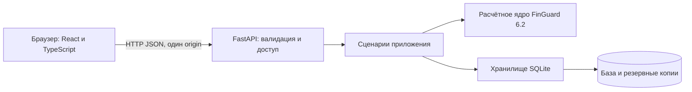

# Архитектура

`frontend/src/pages/` содержит пять экранов. Общие элементы находятся в `components/`, типы — в `types.ts`, запросы — в `api.ts`. На клиенте нет независимого финансового движка. Диаграмма строится по ежедневным точкам сервера; денежные суммы для записи передаются целыми копейками.

`backend/app.py` отвечает за транспорт, строгие входные модели, ограничения файлов, CSRF, Basic Auth и выдачу собранного интерфейса. `backend/service.py` содержит сценарии приложения и координирует операции. `backend/core/` содержит расчёты, CSV, платежи, решения, SQLite и валидацию сценариев из desktop 6.2. Изменены только импорты модулей на относительные; финансовые правила сохранены.

## Согласованность

На один сценарий приложения открывается одно соединение SQLite. Операции сервиса защищены блокировкой одного процесса. Клиент получает `revision` по всем данным и передаёт её при записи; если другая вкладка уже внесла изменения, запрос отклоняется до записи. Эта версия запускается одним процессом, без нескольких Uvicorn workers и без нескольких реплик.

Предпросмотр CSV хранится только в памяти сервера до 15 минут (не более 16). При подтверждении хранилище повторно проверяет подпись исходных данных и предпросмотра. Сервер не доверяет переданному клиентом списку для импорта.

Сохранённые сценарии содержат определения действий, а не кэш результатов. Каждый участник привязан к дате, сумме, статусу и реквизитам. Изменение участника отклоняет весь сценарий. При изменении общего остатка или другого контекста сохранённый вариант пересчитывается по актуальным данным.

Просроченный плановый расход учитывается сегодня. Просроченное поступление требует новой ожидаемой даты и не финансирует прогноз. Исполненные операции уже входят в фактический остаток и не проигрываются повторно. Горизонт включает день 0 и последний день. Изменения поступлений и дополнительный расход применяются один раз на весь каскад.

## API

Справочник без внешних CDN: `/api/docs`; машиночитаемая схема: `/api/openapi.json`.

| Метод | Путь | Назначение |
| --- | --- | --- |
| GET | /api/state | Реестр, проверки, остаток, прогноз, сценарии, revision и CSRF |
| POST | /api/balance | Фактический остаток и его дата |
| POST | /api/payment | Статус и дата операции |
| POST | /api/review | Ручное решение по дублю |
| POST | /api/scenario/calculate | Валидация и расчёт каскада |
| POST | /api/scenario/save | Сохранение определения |
| GET | /api/scenario/{id} | Загрузка и повторный расчёт |
| GET | /api/scenario/compare | Пересчёт всех сохранённых вариантов |
| POST | /api/scenario/delete | Удаление сохранённого варианта |
| POST | /api/import/preview | Предпросмотр CSV в base64 |
| POST | /api/import/apply | Подтверждение по серверному токену |
| POST | /api/backup/create | Создание SQLite-копии |
| GET | /api/backup/download | Скачивание существующей копии по имени |
| POST | /api/backup/restore | Восстановление локальной или загруженной копии |
| POST | /api/demo | Загрузка тестового набора с копией до замены |
| POST | /api/selfcheck | Девять внутренних проверок |
| GET | /api/sample, /api/export | CSV-пример и JSON-отчёт |

## Следующее развитие

Для совместной эксплуатации несколькими организациями нужны аккаунты, права, аудит и изоляция данных. Для нескольких серверных процессов нужно заменить SQLite-слой на PostgreSQL и перенести токены предпросмотров в общее хранилище; проверка revision должна стать транзакционной на уровне БД. Эти возможности в текущей версии не заявляются как реализованные.

Не размещайте данные и резервные копии внутри каталога выдаваемого frontend. Доступ к произвольным файловым путям API не предоставляет.
